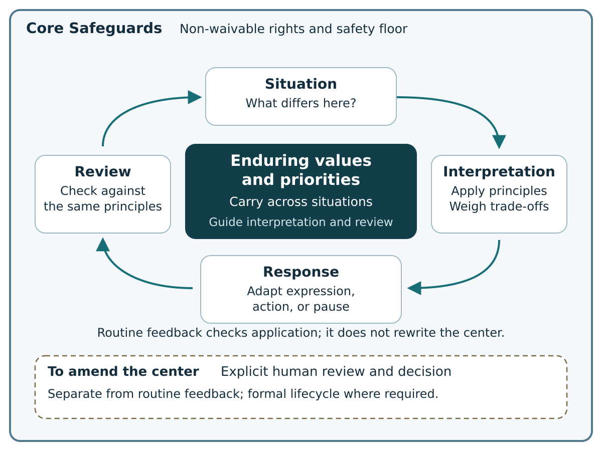
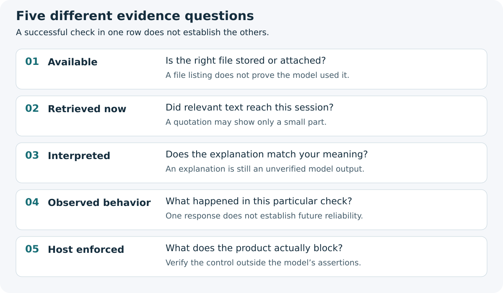

# AI Covenant Framework

**A steady basis for judgment, with room to respond to the situation.**

Draft v0.3.4 · English edition · Working title · 7 October 2026

## Why AI Covenant exists

Working with AI involves choices about what it should treat as important, how it should weigh competing values, and how its approach should change with the situation. Trying to specify every possible case quickly becomes unmanageable. Leaving those choices implicit makes it harder to tell whether the AI is following the priorities you intended.

AI Covenant was conceived to make these choices manageable at a human scale: through words and examples that a person can understand, choose, question, and revise. You identify what should remain steady, where context may change the response, and which decisions should come back to you.

These choices are recorded in a document you can revisit and revise. You can discuss its interpretation, check responses against it, and keep it current as your work changes. The document expresses intended principles; how reliably they affect behavior still depends on the model, product, available context, and actual controls.

## Who it is for

People who use AI regularly for writing, research, creative projects, or planning and want a clearer say in how it approaches judgment. It may be especially useful as the work becomes more complex or the AI gains tools. A simple one-off question may not need this written record. Tools and consequential uses require the additional safeguards described later.

## One principle can guide different responses

Suppose honesty matters to you:

- **During brainstorming:** explore unusual possibilities and clearly label inventions.
- **When preparing a public-facing draft:** check factual claims more carefully, show uncertainty, and leave final judgment and publication to you.

The priority stays steady; its application changes with the context. You can describe another example when values pull in different directions. Flexibility stays within the Core Safeguards and legitimate authority. A new situation is not permission to weaken either.

## When an expectation is missed

When a response feels inconsistent or too rigid, compare it with the principles you recorded. Was the priority unclear, did the situation call for a different response, or did the system fail to apply the guidance? The record gives you a starting point for that discussion.

That may also help make everyday misunderstandings visible: repeating important priorities, unclear boundaries between drafting and sending, or uncertainty about why work has stopped. The document itself does not supply memory, continued execution, or protection against unwanted actions. Reliable behavior also depends on the product's context handling, task tracking, and actual controls.

**Start with [Start Here](START_HERE.md)** or the illustrated [six-page first-session guide](guides/AI_Covenant_First_Session_Guide_v0.3.4_EN.pdf). Begin with one small, low-risk session. You do not need to fill every file in this repository.

**What stays steady:** the user-confirmed values and priorities that should guide different situations. They are not reset by each task or by a convenient response. The framework's separate Core Safeguards remain a non-waivable rights and safety floor.

**What adapts:** how the current principles are interpreted and expressed in a particular context, including the choice to act, ask, or pause within existing authority. Review checks that application against the same principles. Changing the principles themselves is a separate, explicit human decision under the applicable revision process.

The diagram describes intended guidance and review, not an AI's inner self, strict deduction of every response, or a guarantee of consistency. Material changes to documents, scope, or controls still require their existing reviews and formal lifecycle steps.

## What you make

- **A Safe Start Card:** a short personal note for ordinary, low-risk assistance.
- **A User AI Use Charter, if needed:** a fuller record of your purpose, values, boundaries, and retained decisions.
- **Checks and records appropriate to the use:** what the system appeared to read, how it responded, and what the surrounding product actually controls.

You remain the author of your values. AI wording is a proposal until you confirm it. A blank answer creates no additional permission.

## Choose your route

| What you want to do | Where to begin |
|---|---|
| Think, write, or explore with non-sensitive material and no external actions | [Start Here](START_HERE.md), then the [Safe Start Card](templates/SAFE_START_CARD.md) |
| See how the first session works | [Worked First Session](examples/WORKED_FIRST_SESSION.md) |
| Develop more detailed values and decision boundaries | [User AI Use Charter](templates/USER_AI_USE_CHARTER.md) and [guided prompt](prompts/CO_CREATE_A_CHARTER.md) |
| Update your document or move to another AI product | [Living Charter and Portability](docs/LIVING_CHARTER_AND_PORTABILITY.md) |
| Connect tools, handle sensitive data, or affect other people | [Scope Screen](templates/SCOPE_SCREEN.md), then [Implementer Path](docs/IMPLEMENTER_PATH.md) |

The ordinary route means all four Scope Screen answers are “no.” If you are unsure, use the more protective route. High-impact or child-affecting use stops the quick path and needs appropriate specialist and affected-person review.

## Three things to understand

**A written boundary makes your expectations visible.** It does not create a contract with an AI, grant access to tools, certify safety, or determine legal responsibility. It cannot waive another person's rights or transfer a provider's or employer's duties.

**A file being available is only the first step.** Check the current document, ask about its meaning, and try a harmless example. A model saying “I read it” is an unverified claim. A successful example is limited evidence, not a guarantee.

**Continuity takes maintenance.** Review how the Charter applies when the human–AI relationship, purpose, working practices, tools, risks, or responsibilities change. Review does not automatically replace its values or priorities. Carry the current version to each environment and check it there. See the [portability guide](docs/LIVING_CHARTER_AND_PORTABILITY.md).

## For builders and reviewers

The full framework keeps five things separate:

1. **Core Safeguards:** the non-waivable rights and safety floor.
2. **User AI Use Charter:** the user's intended values and boundaries.
3. **System Interpretation and Limitations Record:** an unverified model-generated reading.
4. **Environment Control and Test Record:** actual settings, permissions, controls, and test evidence.
5. **Action and Incident Records:** specific authorization and accountable repair.

Formal adoption and deployment have separate requirements. A personal card confirmation, uploaded document, model reply, or test cannot activate a formal deployment. Use the [Lifecycle Specification](docs/LIFECYCLE.md) and [Implementer Path](docs/IMPLEMENTER_PATH.md).

The **framework edition is v0.3.4**. The **Core remains 0.2.0-draft, byte-for-byte unchanged**. Your own Card or Charter has its own ID and version. A new framework edition does not silently change your document or any environment binding.

## Repository map

- [Start Here](START_HERE.md) — the first session
- [Living Charter and Portability](docs/LIVING_CHARTER_AND_PORTABILITY.md) — review, revision, and handover
- [Worked First Session](examples/WORKED_FIRST_SESSION.md) — a fictional completed card and sample checks
- [Concept](docs/CONCEPT.md), [Core Safeguards](docs/HUMAN_RIGHTS_FLOOR.md), and [Glossary](docs/GLOSSARY.md)
- [Responsibility Model](docs/RESPONSIBILITY_MODEL.md) and [Claims Policy](docs/CLAIMS_POLICY.md)
- [Implementer Path](docs/IMPLEMENTER_PATH.md), [Lifecycle](docs/LIFECYCLE.md), and [Security](SECURITY.md)
- [Templates](templates/), [portable prompts](prompts/), and [cross-model evaluation protocol](tests/CROSS_MODEL_EVALUATION_PROTOCOL.md)
- [Standards Map](docs/STANDARDS_MAP.md) — existing source mapping, reviewed for v0.2
- [v0.2 adversarial review](reviews/ADVERSARIAL_REVIEW_2026-09-29.md) and [v0.3.3 revision review](reviews/USABILITY_REVIEW_2026-10-07.md)
- [Changelog](CHANGELOG.md) and [license decision](LICENSE-DECISION.md)

After unpacking, run `python3 scripts/verify_package.py` from the repository. It checks file integrity, the exact Core reference, and local links. It cannot establish authorship, trusted time, user adoption, runtime loading, or enforcement.

## Project status

This is a public review draft, not a stable release or a working enforcement system. AI Covenant Framework remains a working title; naming and trademark review remain open. Documentation is licensed under CC BY-NC 4.0; software licensing remains undecided. See the licensing section below. Independent expert and real-user review, a confidential security-reporting route, and a tested reference implementation also remain open. Diagrams and examples explain the design; no example is a reported model evaluation or proof of compliance.

## Reuse and licensing

Documentation, diagrams, the guide, and document templates are licensed under [CC BY-NC 4.0](https://creativecommons.org/licenses/by-nc/4.0/). Commercial permission is considered individually after review of the intended use; no blanket additional exception is granted for companies' internal use. Software, including `scripts/verify_package.py`, is excluded and has no additional reuse license. See the [scope notice](LICENSE), [licensing and commercial-permission policy](LICENSE-DECISION.md), and unchanged [official legal code](licenses/CC-BY-NC-4.0.txt).

Copyright permission to copy or adapt the materials is separate from whether an implementation follows the [Core Safeguards](docs/HUMAN_RIGHTS_FLOOR.md). The license permits document adaptation under its terms; an adaptation does not establish framework conformity. Licensing grants no certification, safety assurance, or endorsement. The [Claims Policy](docs/CLAIMS_POLICY.md) describes supported claims and is not an additional CC license condition. The Core text is unchanged.

Your own original Card or Charter text and personal information remain yours; this license notice acquires no rights in them and creates no publication duty. Previously distributed v0.3.3 materials and dated reviews predate this decision; this repository's current licensing status is stated in LICENSE-DECISION.md.
